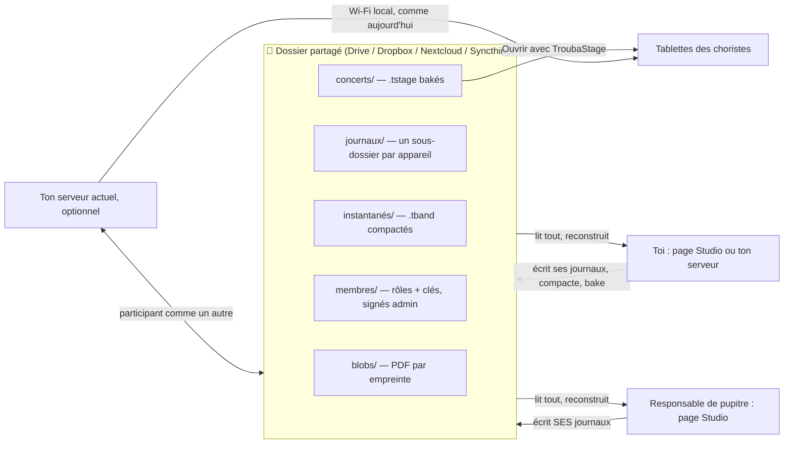

# WIP — TroubaStack partagé, sans serveur à maintenir

> **Statut : document de réflexion (WIP), écrit pour VLL. Ce n'est PAS une tâche.**
> Aucun lane ne doit agir dessus, et rien ici n'est décidé. C'est une architecture « idéale » proposée pour
> discussion. Une note de conception ne sera faite (avec critique indépendante, puis découpage en tâches)
> qu'après lecture et arbitrage par VLL.
>
> Auteur : Fable (architecte), 2026-10-18. Écrit en français pour VLL.

---

## 0. En une phrase

**Le dossier partagé (Drive, Dropbox…) devient le serveur.** Chaque appareil n'écrit que **ses propres
fichiers** : un journal d'opérations, plus des PDF nommés par leur empreinte. Tous les appareils **lisent
tout** et reconstruisent **le même état**. Il n'y a donc jamais de conflit de synchronisation. Ton `.tband` reste la
sauvegarde et le point de départ, et ton serveur actuel n'est plus qu'un participant parmi d'autres.

---

## 1. Le problème à résoudre

### 1.1 Ce que tu as dit, rassemblé

- Des choristes veulent des tablettes pour les concerts. Ils sous-estiment le temps d'annotation.
- **Pas de MCO.** Tu ne veux pas maintenir un serveur pour la chorale.
- **« Neuneu-savvy ».** Une personne d'un certain âge doit pouvoir s'en servir sans installer de serveur.
- **Des responsables de pupitre** annotent pour leur pupitre.
- **Du partagé** : une source unique.
- **Une app « un peu native »** qui embarque son serveur HTTP et navigue dessus.
- **Une source unique sur un Drive**, si possible au format **`.tband`**, qu'on décompresse pour fusionner.
  **Pas de conflit grâce à la répartition des rôles.**
- **Ton serveur synchronisé dans les deux sens** avec cette source.
- **« Quid des id de fichier ? »** Les identifiants doivent survivre aux échanges.
- Le côté légal est réglé : la chorale a un accord pour les partitions.

### 1.2 Contraintes implicites (déjà vraies aujourd'hui)

- **Hors ligne d'abord.** Une répétition ou un concert se passe souvent sans réseau. La tablette lit déjà un
  `.tstage` hors ligne.
- **Rien ne doit se perdre.** C'est la leçon du bug de perte de recadrage du 2026-10-18.
- **Garder l'investissement existant** : le cœur Go, Studio, l'app Stage, le moteur de dessin `ink`, le bake et
  le format `.tband` v2.

### 1.3 Pourquoi les solutions évidentes coincent

| Option | Ce qui coince |
|---|---|
| **Un serveur hébergé pour la chorale** | C'est exactement la maintenance que tu refuses : mises à jour, sauvegardes, sécurité, panne la veille d'un concert. |
| **Ton serveur ouvert via Tailscale** | Faisable, mais ton PC doit être allumé quand les autres travaillent, et c'est toi le support. |
| **Un `.tband` zippé unique sur Drive** | 134 Mo pour un groupe réel. Chaque annotation ré-envoie tout. Deux sauvegardes proches donnent « fichier (1) », et l'une des deux est perdue. |
| **Le `.tband` décompressé sur Drive + fusion à trois versions** | Ça marche. C'est la phase 1 ci-dessous. Mais il faut garder une « base » par appareil, détecter les copies de conflit de Drive, et deux écrivains touchent encore le même `annotations/<morceau>.json`. |
| **Une bibliothèque CRDT générique (Automerge…)** | Lourde, peu de support Go, et surdimensionnée. Notre domaine est simple : des objets à identifiant, un seul auteur par chose. |
| **git sur un dossier Drive** | Un dépôt git synchronisé par un outil de fichiers finit corrompu. La sémantique de git est bonne, son stockage ne l'est pas ici. |

L'architecture ci-dessous reprend ton idée (un `.tband`, des rôles, ton serveur dans les deux sens) et la pousse
jusqu'au bout : **on ne fusionne plus des fichiers, on rejoue des opérations.**

---

## 2. Ce que l'architecture résout (vue d'ensemble)

| Besoin | Mécanisme |
|---|---|
| Partagé, source unique | Le dossier partagé contient tout : les PDF, les journaux, les instantanés et les concerts. |
| Zéro serveur à maintenir | Aucun processus permanent. Le stockage est celui de Drive (ou équivalent), l'hébergement de la page web est statique et gratuit. |
| Pas de conflit de synchro | **Un seul écrivain par fichier.** Les PDF sont immuables et nommés par leur empreinte. |
| Pas de conflit métier | Un auteur par chose (les rôles), des identifiants stables, un ordre déterministe des opérations. |
| Responsables de pupitre | Un calque par pupitre. Seul son propriétaire l'édite, et il est visible par défaut pour le pupitre (le modèle existe déjà : `Access RO` + `RoleTag`). |
| Simple pour tout le monde | Choriste : l'app tablette et un fichier. Responsable : une page web, rien à installer. Admin : la même page, ou ton serveur. |
| Le `.tband` comme format | **Instantané = `.tband` v2.** C'est la sauvegarde lisible, l'export, l'import, et le point de départ d'un nouvel appareil. |
| Ton serveur dans les deux sens | Il devient un **participant** : il lit et écrit le dossier comme les autres. |
| Identifiants de fichiers | Des UUID stables dans le `.tband`, réutilisés à l'import. Un renommage ne casse plus rien. |
| Hors ligne | Chacun travaille sur sa copie locale. Les opérations partent quand Drive synchronise. |
| Droits sans serveur | Les opérations sont **signées**. Chaque appareil applique la même règle de rôles à la reconstruction. |



---

## 3. Comment ça marche

### 3.1 Le dossier partagé

```
📁 TroubaStack – Chorale/
├── chorale.json                    nom, identifiant de groupe, clé publique de l'admin (« racine de confiance »)
├── membres/
│   ├── <username>.json             nom affiché, rôle, pupitre, clés publiques de ses appareils — SIGNÉ par l'admin
│   └── demandes/<username>.json    demande d'adhésion écrite par le nouveau venu (non signée)
├── blobs/
│   └── <sha256>.pdf                un PDF = un fichier nommé par son empreinte, jamais modifié
├── journaux/
│   └── <appareil>/                 UN SEUL appareil écrit dans ce dossier
│       ├── 2026-10-18T21-04-11Z-0001.ops
│       └── 2026-10-18T21-09-37Z-0002.ops
├── instantanés/
│   ├── 2026-10-18.tband            checkpoint compacté (format .tband v2, zippé)
│   └── 2026-10-18.vecteur.json     « contient toutes les opérations jusqu'à … » pour chaque appareil
└── concerts/
    └── <concert>-rev29.tstage      bundles pour les tablettes
```

**Règles d'or :**
1. **Un fichier n'a qu'un seul écrivain**, et une fois écrit il n'est **plus jamais modifié**. Les
   journaux sont faits de petits fichiers immuables (un par sauvegarde ou par lot), pas d'un gros fichier auquel on ajoute
   des lignes. Drive ne voit donc jamais deux écritures concurrentes sur le même fichier, et un lecteur ne lit jamais un
   fichier à moitié envoyé (voir 3.3).
2. **Les PDF sont adressés par leur contenu.** Le même PDF ajouté par deux personnes donne le même nom de fichier. Il n'y a
   ni doublon ni conflit, et ils se dédupliquent tout seuls. Le format existant porte déjà `blobHash` dans `repertoire.json`.
3. **Rien n'est jamais supprimé à chaud.** Une suppression est une opération (une « pierre tombale »), et le
   nettoyage ne se fait qu'à la compaction.

### 3.2 L'identité stable (prérequis, utile dès maintenant)

**Aujourd'hui, dans le `.tband` v2**, morceaux, fichiers et setlists n'ont **pas d'identifiant** : seulement un slug ou un
nom. L'import leur crée de **nouveaux UUID** (`bandio.go`). Les calques et les annotations gardent leurs UUID, mais un calque pointe vers son fichier
**par le nom** (par exemple `"file": "Partition.pdf"`).

**Ce qu'il faut :** ajouter un `id` (UUID) facultatif aux morceaux, fichiers, setlists et membres, et faire
référencer un fichier par un calque via `fileId`, en gardant le nom en repli. À l'import :
- l'identifiant est **réutilisé** s'il est connu ;
- sinon on retombe sur la clé naturelle (slug, nom) ;
- en dernier recours seulement, on crée un nouvel identifiant.

C'est rétro-compatible : un vieux `.tband` sans `id` marche comme aujourd'hui.

Sans ça, rien de ce qui suit n'est sûr : un renommage ressemblerait à « supprimer, puis ajouter », et les annotations
d'un autre deviendraient orphelines.

### 3.3 Les journaux d'opérations

Chaque action est une **opération** : créer, modifier ou supprimer une annotation, créer un calque, renommer un morceau,
poser un recadrage, ajouter un fichier, modifier une setlist… Le moteur fait **déjà** circuler les annotations comme
des opérations (`domain.Mutation` : type, objet, calque, auteur, version de base, horodatage client). On généralise
le principe au répertoire et aux setlists.

**Format d'un fichier de journal** (JSON Lines, lisible) :

```
{"v":1,"appareil":"pc-alice-7f3a","signé":"ed25519:…","de":"2026-10-18T21:04:11.120Z#0","à":"…#14"}
{"hlc":"2026-10-18T21:04:11.120Z#0","auteur":"alice","type":"objet.créer","objet":{"uuid":"…","calque":"…","page":3,…}}
{"hlc":"2026-10-18T21:04:12.881Z#0","auteur":"alice","type":"objet.modifier","uuid":"…","champs":{"points":[…]}}
…
{"fin":true,"n":15,"sha256":"…"}
```

- La ligne `fin` (avec le nombre d'opérations et une empreinte) dit au lecteur que le fichier est **complet**.
  Un fichier sans `fin` valide est ignoré jusqu'au prochain passage : c'est le cas d'un envoi Drive en cours.
- L'appareil écrit le fichier dans un nom temporaire, puis le **renomme**. Le nom final n'apparaît qu'une fois le fichier
  entier.
- **Fréquence :** un petit fichier par sauvegarde, ou par lot de quelques secondes en mode « en direct ». À la compaction,
  ils sont regroupés.

### 3.4 L'ordre et la fusion

- **Horloge hybride (HLC).** Chaque opération porte un horodatage `heure physique + compteur logique`. Une horloge
  d'appareil un peu fausse ne casse pas l'ordre, et deux opérations ne sont jamais à égalité, l'appareil servant
  de départage.
- **Reconstruction :** dernier instantané, puis toutes les opérations postérieures de tous les journaux, triées par HLC.
  Le résultat est **le même sur tous les appareils** (déterministe).
- **Règles de fusion, par objet :**
  - une annotation, un calque ou un recadrage : **la dernière écriture gagne, champ par champ**. Grâce aux rôles, il n'y a
    en pratique qu'un seul auteur ;
  - une suppression l'emporte sur une modification antérieure. Une modification **postérieure** à une suppression
    réapparaît, comme un « annuler » distant, et c'est signalé ;
  - **le répertoire** (morceaux, fichiers, setlists, recadrages) n'est écrit que par l'admin, donc il n'a pas de vrai conflit.
- **L'ancrage (le « ça suit » des annotations, T194–T197).** Aujourd'hui c'est le serveur qui décide des liens. Sans
  serveur, la décision doit être une **fonction déterministe de l'état** (marques + historique de la grille), recalculée
  à l'identique par chaque appareil. C'est déjà presque le cas : la projection est paresseuse, calculée à l'affichage et
  au bake. **Point d'attention n°1** à vérifier en conception.

### 3.5 Les instantanés et la compaction

- **Qui :** l'appareil de l'admin (ou ton serveur), de temps en temps ou à la demande, avec un bouton « Compacter ».
- **Quoi :** il écrit un `.tband` v2 complet (l'état reconstruit), plus un **vecteur** : pour chaque appareil, la dernière
  opération incluse.
- **Un nouvel appareil** charge le dernier instantané, puis rejoue seulement ce qui vient après. C'est rapide.
- **Le nettoyage :** les journaux entièrement couverts par un instantané peuvent être archivés après un délai (par
  exemple 30 jours), pour laisser aux appareils hors ligne le temps de revenir.
- **Bonus :** chaque instantané est une sauvegarde lisible par l'app actuelle (import `.tband`). Ton dossier
  `~/troubastack-bands` devient simplement « le dernier instantané décompressé ».

### 3.6 Les droits sans serveur : signatures et règles de rôles

Qui a accès au dossier Drive peut **écrire n'importe quoi** dedans. On ne peut pas l'empêcher, mais on peut le
**rendre inopérant** :
- chaque **appareil** a une paire de clés (ed25519). La clé privée ne quitte jamais l'appareil ;
- `membres/<nom>.json` liste le rôle, le pupitre et les clés publiques des appareils du membre. **Ce fichier est signé par
  la clé de l'admin**, ancrée dans `chorale.json` ;
- chaque fichier de journal est **signé** par son appareil ;
- à la reconstruction, chaque appareil **vérifie les signatures et applique la table des rôles**. Une opération
  invalide est **ignorée**, et signalée (« 3 opérations ignorées de l'appareil X : droits insuffisants »).

| Rôle | Peut |
|---|---|
| **Admin** (toi, éventuellement un second) | Tout : répertoire, recadrages, setlists, membres, compaction, bake |
| **Chef** | Son calque « chef », obligatoire et visible de tous |
| **Responsable de pupitre** | **Son** calque de pupitre (créer, modifier, supprimer ses objets) |
| **Choriste** | Ses calques personnels uniquement |

**Ce que ça protège :** l'intégrité. Personne ne peut écrire au nom d'un autre, ni toucher le répertoire sans être
admin.

**Ce que ça ne protège pas :** quelqu'un qui a accès en écriture au dossier peut **supprimer des fichiers**. La parade, c'est
la corbeille et l'historique de Drive, et les instantanés. Un appareil peut aussi refuser de suivre une suppression
massive soudaine et prévenir l'admin.

**La révocation :** l'admin retire la clé de l'appareil perdu de `membres/<nom>.json` (re-signé). Les opérations futures de
cet appareil sont alors ignorées. Celles d'avant la révocation restent, puisqu'elles étaient légitimes.

**La perte de la clé admin :** prévoir une **clé de secours** (imprimée sur papier, ou chez un second admin).

**Les calques personnels :** tous ceux qui ont accès au dossier peuvent techniquement les lire. Option future : les
chiffrer avec la clé de leur propriétaire. Pour une chorale, probablement inutile.

### 3.7 Les trois façons de participer

**a) Studio dans le navigateur, sans rien installer (la pièce maîtresse)**
- Une **page web statique**, hébergée gratuitement (GitHub Pages, comme le site actuel). Il n'y a **pas de serveur**
  derrière : la page télécharge le code, et tout le reste se passe dans le navigateur.
- Le **cœur Go compilé en WebAssembly** fait la reconstruction, la validation, la fusion, les règles de rôles et la
  projection d'ancrage. C'est **le même code** que le serveur, il n'y a pas de deuxième implémentation.
- **pdf.js** rend les PDF. Le moteur de dessin des annotations (`ink`) est déjà en TypeScript, et Studio existe déjà.
- **L'accès au dossier :** Chrome et Edge sur ordinateur savent ouvrir un dossier local (la « File System Access API »),
  ici le dossier que l'app Google Drive pour ordinateur synchronise. La page mémorise le dossier.
- **Limite :** cette API n'existe ni dans Safari ni dans Firefox, ni (de façon fiable) sur tablette. Le Studio
  navigateur est donc « ordinateur + Chrome ou Edge ». C'est acceptable pour les responsables de pupitre.

**b) L'app de bureau (variante)**
- Le binaire Go actuel, qui se compile **déjà** pour Windows (vérifié le 2026-10-18 : `troubacore.exe`, 19 Mo, sans
  modifier de code), ouvert dans une fenêtre et pointé sur le dossier partagé au lieu de sa base.
- Utile pour qui n'a pas Chrome ou Edge, ou pour baker avec les mêmes outils que le serveur (poppler).
- C'est un emballage autour du même cœur. À considérer seulement si (a) ne suffit pas.

**c) Ton serveur actuel, comme participant**
- Il lit le dossier et écrit son propre journal, avec sa clé d'appareil.
- Il reste utile pour **baker** (poppler, le moteur d'annotations), servir les tablettes **en Wi-Fi local** (la découverte
  existe déjà), et faire la **compaction** automatique.
- **Il n'est requis pour rien.** S'il est éteint, la chorale continue.

### 3.8 Le bake et les tablettes

- **Où baker :** sur ton serveur (comme aujourd'hui), dans l'app de bureau, ou **dans le navigateur** (pdf.js pour le rendu,
  recadrage, `ink` pour les annotations, puis un zip `.tstage`). Le résultat va dans `concerts/`.
- **Un seul moteur de rendu par concert.** pdf.js et poppler ne produisent pas les mêmes pixels. Un concert baké par
  l'un puis l'autre changerait les empreintes de pages, et les notes de répétition des tablettes passeraient en « page
  modifiée ». La règle serait : le moteur de rendu est une propriété du concert. **Point d'attention n°2.**
- **Côté tablettes, v1 (simple et sûre) :** le choriste ouvre `concerts/<concert>.tstage` depuis l'app Drive, choisit
  « Ouvrir avec TroubaStage », et le fichier est importé. C'est le bouton Import qui existe déjà.
- **v2 :** l'app tablette « s'abonne » au concert. Elle mémorise le fichier Drive et vérifie s'il en existe une nouvelle
  version, comme le fait déjà la mise à jour de l'app (A88). Elle télécharge et applique, et les notes perso restent sur
  les pages inchangées.
- **Les notes de répétition qui remontent :** aujourd'hui elles passent par ton serveur (T170). Sans serveur, la
  tablette déposerait un petit fichier `journaux/<tablette>/…` via le menu Partager d'Android, toujours avec un seul
  écrivain. C'est à concevoir plus tard.
- **iPad :** l'app compile pour iOS, mais sa distribution passe par l'App Store ou TestFlight, avec un compte
  développeur payant. C'est indépendant de cette architecture, et toujours à trancher.

---

## 4. Les modalités, scénario par scénario

### 4.1 Toi : créer l'espace de la chorale (une fois)
1. Tu crées un dossier partagé « TroubaStack – Chorale » dans ton Drive.
2. Sur la page Studio : « Créer une chorale » → choisir ce dossier. La page génère `chorale.json` et ta clé admin
   (avec une **clé de secours à imprimer**).
3. « Importer un `.tband` » → l'instantané initial est écrit, avec les PDF dans `blobs/`. Ton serveur peut faire de
   même : il exporte le groupe, ce qui donne le premier instantané.

### 4.2 Inviter un responsable de pupitre
1. Tu partages le dossier Drive avec lui, avec les droits d'écriture. C'est le partage Drive normal.
2. Tu lui envoies un **lien d'invitation**, ou un QR code. Il contient l'adresse de la page Studio et l'identité de la
   chorale.
3. Il installe l'app Google Drive pour ordinateur, si ce n'est pas déjà fait. C'est **la seule installation**.
4. Il ouvre le lien → « Choisir le dossier de la chorale » → « Qui es-tu ? » → il écrit `membres/demandes/<nom>.json`.
5. De ton côté, Studio t'affiche « Nouvelle demande : Alice (Sopranes) » → **Accepter** → `membres/alice.json` est signé.
6. Chez lui, la page passe en mode « Responsable Sopranes ». Il voit tout et n'édite que son calque.

### 4.3 Le quotidien d'un responsable de pupitre
- Il ouvre la page. Studio relit le dossier (ce qui a changé depuis la dernière fois) et affiche l'état à jour.
- Il annote son calque Sopranes. Chaque sauvegarde écrit un petit fichier de journal, et Drive l'envoie.
- Les autres voient ses annotations **au prochain passage de synchro** : de quelques secondes à quelques minutes. Ce
  n'est **pas du temps réel**.
- **Hors ligne :** il annote quand même. Tout part au retour du réseau.

### 4.4 Toi : préparer un concert
1. Tu ajoutes des PDF, recadres, construis la setlist. Ce sont tes opérations d'admin.
2. « Baker le concert » → le `.tstage` est écrit dans `concerts/`.
3. Tu annonces aux choristes « nouvelle version du concert » (WhatsApp, etc.). En v2, les tablettes abonnées le voient
   toutes seules.

### 4.5 Un choriste
1. Il installe l'app Android (lien ou QR vers l'APK). Ensuite elle se met à jour toute seule (A88).
2. Il ouvre le `.tstage` depuis Drive (lien partagé en lecture seule) → « Ouvrir avec TroubaStage ».
3. Il lit, tourne les pages, voit le calque du chef et celui de son pupitre par défaut. Il peut griffonner ses notes
   perso, qui restent sur sa tablette.

### 4.6 Une erreur, une perte
- **J'ai supprimé une annotation par erreur :** « annuler » écrit l'opération inverse.
- **Quelqu'un a vidé le dossier Drive :** restaure depuis la corbeille ou l'historique Drive, ou réimporte le dernier
  instantané (que tu as aussi en local).
- **Un appareil volé :** tu révoques sa clé (4.7).
- **Les PDF sont corrompus :** l'empreinte ne correspond plus. L'appareil le détecte et refuse de s'en servir.

### 4.7 Quelqu'un change d'ordinateur, ou quitte la chorale
- **Nouvel ordinateur :** il reprend 4.2, puis tu acceptes le nouvel appareil. L'ancien peut être révoqué.
- **Départ :** tu retires le membre (re-signature), et tu arrêtes le partage Drive. Ses annotations passées restent ;
  tu peux les archiver ou transférer son calque à un autre responsable (opération admin).

---

## 5. Ce que ça ne résout pas (honnêtement)

- **Pas de temps réel.** La latence est celle de Drive : de quelques secondes à quelques minutes. Pour annoter chacun de
  son côté, c'est très bien. Pour annoter **ensemble en direct**, il faudrait un relais (voir 7).
- **Le Studio navigateur exige Chrome ou Edge sur ordinateur.** Ni Safari, ni Firefox, ni tablette (sauf l'app
  de bureau en variante).
- **Le mode « fichiers en ligne uniquement » de Drive pour ordinateur** (les fichiers ne sont pas téléchargés tant
  qu'on ne les ouvre pas) : il faut configurer le dossier en **« disponible hors connexion »** (mode miroir), ou bien
  l'app doit forcer le téléchargement. C'est **le piège d'installation n°1**, à mettre dans le guide.
- **Les quotas :** 15 Go gratuits chez Google. Un groupe pèse quelques centaines de Mo de PDF, plus les `.tstage`
  (environ 60 Mo par concert). Il faut nettoyer les vieux concerts.
- **Le vandalisme par suppression** n'est pas empêché, seulement réparable (3.6).
- **Distribuer sur iPad** reste un problème à part.
- **La complexité :** c'est un vrai chantier (environ 6 phases, voir 6). Chaque phase est utile seule, mais le tout
  représente plusieurs semaines de travail de lane, avec revues.

---

## 6. Le chemin incrémental (chaque marche sert toute seule)

| Phase | Contenu | Utile seul parce que… | Ordre de grandeur |
|---|---|---|---|
| **P0 – Identifiants stables** | `id` dans le `.tband` v2, réutilisés à l'import, avec les clés naturelles en repli | Tes sauvegardes deviennent restaurables sans casser les références (bakes, notes, recadrages) | Petit |
| **P1 – Import-fusion + dossier** | Le serveur sait **fusionner** un `.tband` décompressé dans un groupe existant (à trois versions, par identifiant), et exporter vers un dossier | **Ta première idée**, en mode manuel : « synchroniser avec le Drive » d'un bouton | Moyen |
| **P2 – Pupitres + export choristes** | Calques de pupitre (propriétaire seul + pupitre), pupitre de chaque choriste, `.tstage` sans les calques perso, page d'aide et QR | Les responsables annotent sur ton serveur (Tailscale) **en attendant**, et les choristes lisent | Petit à moyen |
| **P3 – Journaux par appareil** | Opérations signées, HLC, reconstruction, instantanés et compaction. Le serveur devient un participant | **La synchro devient automatique**, sans conflit, ton serveur dans les deux sens | Gros (le cœur) |
| **P4 – Studio navigateur** | Le cœur en WebAssembly, pdf.js, accès au dossier, hébergement statique | **Plus personne n'a besoin de ton serveur** | Gros |
| **P5 – Bake navigateur + abonnement tablette** | Le `.tstage` produit dans la page, et l'app tablette qui suit une version | Le cycle complet sans serveur | Moyen |
| *(P6 – App de bureau)* | Emballage Windows ou Mac, si (a) ne suffit pas | Pour qui n'a pas Chrome ou Edge | Petit à moyen (emballage) |

P0 et P2 se justifient **même si le reste ne se fait jamais**. P1 est déjà une version utilisable de ton idée de
`.tband` partagé.

---

## 7. Variantes et extensions

- **Un relais temps réel, optionnel :** un tout petit service sans état (ou un simple partage WebRTC) qui
  pousse les nouvelles opérations aux appareils connectés en même temps. Le dossier resterait la vérité, et le relais un
  simple accélérateur. Ça redonnerait le « je vois l'annotation apparaître ». C'est de la maintenance, donc seulement si le besoin
  se confirme.
- **Syncthing au lieu de Drive :** pair à pair, sans compte Google. Tout ce qui précède marche à l'identique, puisqu'il ne faut
  qu'« un dossier synchronisé ». Mais c'est moins « neuneu-savvy ».
- **Plusieurs chorales ou groupes :** un dossier par groupe. La même page Studio gère plusieurs dossiers.
- **Calques personnels chiffrés** (3.6), si la confidentialité entre choristes devenait un sujet.
- **Concerts « figés » :** un concert baké est signé par l'admin, et l'app tablette refuse un `.tstage` non signé par la
  chorale. Ça éviterait qu'un faux concert circule.

---

## 8. Points d'attention à creuser avant toute conception formelle

1. **L'ancrage sans serveur** (T194–T197) : prouver que la décision de lien est une pure fonction de l'état, pour que
   chaque appareil trouve le même résultat.
2. **Un moteur de rendu par concert** (pdf.js ou poppler), pour ne pas invalider les notes de répétition des tablettes.
3. **Le comportement réel de Drive pour ordinateur :** l'ordre d'arrivée des fichiers, les renommages, les fichiers
   partiels, le mode « en ligne uniquement ». **À mesurer, pas à supposer.** Prévoir un banc d'essai avec deux PC.
4. **Les performances de la reconstruction** sur un an de journaux, et la fréquence de compaction.
5. **L'expérience d'adhésion** (4.2) testée avec une vraie personne non technique. Le piège probable : l'installation de
   Drive pour ordinateur et le mode hors connexion.
6. **La migration :** ton serveur actuel, avec son historique (git store), devient le premier instantané, sans rien
   perdre.

---

## 9. Questions pour toi

1. **Le délai** : quelques minutes entre l'annotation d'un responsable et sa visibilité chez les autres, c'est acceptable ?
2. **Tes responsables de pupitre** sont-ils sur ordinateur, avec Chrome ou Edge ? Ou plutôt sur tablette ou Mac ?
3. **Drive ou autre ?** La chorale a-t-elle déjà un espace partagé (Drive d'association, Nextcloud…) ?
4. **Un second admin** (le chef ?) pour ne pas être le seul détenteur de la clé ?
5. **Les choristes :** lecture seule plus notes perso, ou veux-tu un jour qu'ils remontent quelque chose (absences,
   questions sur un passage) ?
6. **La priorité** : P0 + P2 tout de suite (utile dès le prochain concert, avec ton serveur + Tailscale pour les
   responsables), puis on décide de P3 et P4 ?

---

## 10. Ce qui est réutilisé de l'existant

| Existant | Rôle dans l'architecture |
|---|---|
| `domain.Mutation` (le moteur des annotations) | Le modèle des opérations du journal |
| `.tband` v2 (dossier ou zip, JSON lisible) | Le format d'instantané et d'échange |
| `blobHash` (sha256 des fichiers) | Le nommage des PDF dans `blobs/` |
| Calques `Access RO` + `RoleTag` | Les calques de pupitre |
| `ink` (TypeScript, le seul moteur de dessin) | Studio navigateur, et le bake navigateur |
| Le cœur Go | Le serveur, le WebAssembly (navigateur), le binaire de bureau |
| L'import `.tstage` de l'app Stage | La distribution v1 aux tablettes |
| A88 (mise à jour de l'app depuis GitHub) | Installation et mises à jour des tablettes, et modèle de l'« abonnement » v2 |
| T198 (recadrage), l'ancrage T194–T197 | Des opérations admin, et une projection déterministe |
| La découverte en Wi-Fi local | Le serveur reste un accélérateur optionnel en répétition |

---

*Fin du WIP. Rien ici n'est engagé. Prochaine étape, si tu le souhaites : tes réponses à la section 9, puis une note de
conception P0 + P2 (petite, utile vite). Le reste attend que P1 ait été vécu.*
